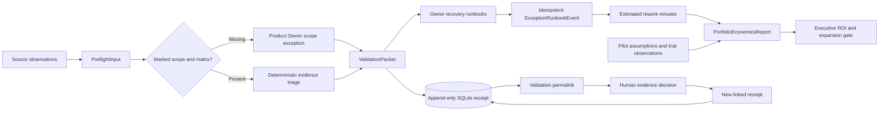

# Architecture and decision provenance

OGI runs three engine functions behind one API. The UI never calculates an authoritative gate locally; it renders server reports. This keeps webhook clients and the dashboard on the same decision path.

## Module 1: pre-flight

`evaluate()` halts on either missing scope or matrix. Otherwise it extracts explicitly named elements, viewport widths, popup variants, and computed/actual measurement language. Requested values are not measurements. Rules assign evidence requirements and accountable roles. A text observation alone cannot become `CONFIRMED_READY`.

The supplied Visual QA rules require inspection artifacts that do not exist in the brief. The engine therefore preserves uncertainty. F1/F2 retain separate source IDs; no automatic merging occurs. Arbitrary additional checklist strings are stored for human interpretation, not presented as rules the engine can semantically execute.

`HumanDecision` records who attested to evidence, a rationale, and artifact references. Confirmations require at least one reference. The API copies the old packet to a new ID and records the parent. The UI and API disclose that references and reviewer names are not independently authenticated in this local release.

## Module 2: recovery

`recover()` selects non-ready observations and groups by accountable role. Each runbook contains three steps: keep claims unconfirmed, perform the owner-specific checks, then attach evidence and hand off. Merge guardrails accompany recovery instructions. Dubai and Los Angeles use IANA zone names so the UI clock accounts for daylight saving time.

Five hours is the simulated elapsed stall, not an effort estimate. Follow-up effort is estimated separately at five minutes per unresolved observation. A single missing scope brief is charged once rather than six times. The database uniqueness constraint on `(validation_id, incident_key)` makes concurrent retries idempotent. Economics traverses human-decision ancestry, retaining the highest estimate per incident key so a later revision cannot erase previously recorded drag.

No Asana delivery occurs. The returned draft contract is the boundary where a future authenticated, retry-aware Asana adapter can be added.

## Module 3: economics

`calculate()` separates pilot sensitivity from trial evidence. The pilot uses the exact supplied baseline, generation/review times, and entry breakdown. Preparation, base rework, estimated duplicates, blended cost, and operating costs are explicit user assumptions. Incident estimates are additive and visible.

The pilot threshold uses unrounded arithmetic. The trial threshold compares the median of assisted totals with the median of matched baselines; it does not compare 252 combined minutes with one AI run. A trial task must explicitly report quality counts. Each individual task/cycle must show no quality regression, so aggregate improvements cannot hide one release's escaped defects.

Returned values describe capacity, including negative capacity when extra work exceeds the baseline. Cash savings stay zero because no cash-reduction evidence is supplied. Recall is unknown; the manual concern acceptance denominator is not invented.

## Storage and deployment scope

SQLite WAL mode supports the local workload. Receipts are immutable through application endpoints and database triggers; receipt SHA-256 checks detect payload corruption. The hash is not a digital signature, and a privileged database editor is outside this integrity boundary.

The static UI escapes user-provided text before inserting it into rendered markup. API input bounds reject extra fields, duplicate identifiers, invalid booleans, and invalid numeric values. The service supplies frame, MIME-sniffing, and referrer headers. These safeguards do not provide authentication or tenant isolation.

This release intentionally keeps LLM execution, evidence retrieval, authenticated role enforcement, task identity across separate preflight runs, recurring stall monitoring, production Asana delivery outside its implemented scope. The API and engine boundaries are ready for those adapters, but the UI never represents them as connected.

Trial evidence is saved as append-only SQLite snapshots with SHA-256 integrity checks. The UI loads the latest snapshot per workflow; exports carry its ID, timestamp, and observations. Earlier snapshots remain in the database. Concurrent saves use last-committed snapshot selection; this pilot does not implement collaborative conflict resolution.
